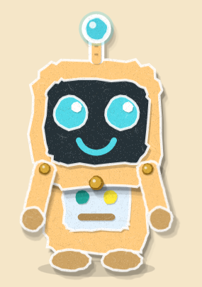
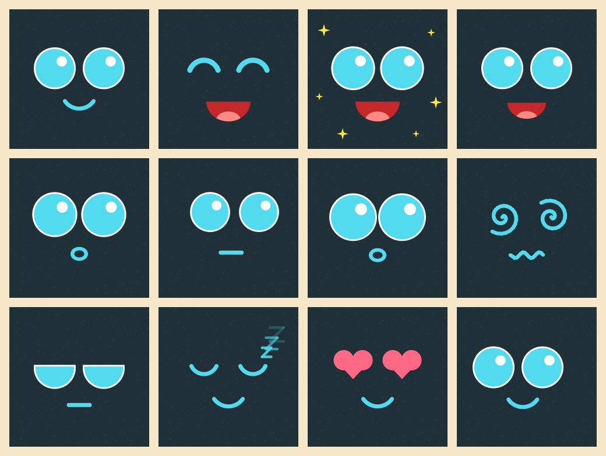

# Rory the Robot 🤖

A real-life **Rory** from *Rory's Talk Trail*: a little talking robot with a
screen for a face, built on the **Waveshare ESP32-S3-Touch-LCD-1.54** board.

| Rory in the app | Rory's robot face (rendered by the firmware) |
|---|---|
|  |  |

## What Rory does (phase 1 — this code)

| You… | Rory… |
|---|---|
| switch her on | opens her eyes, sparkles, says *"Hi friend!"* or *"It's Rory!"* |
| tap her face | *"Beep boop!"* with happy `^ ^` eyes |
| tap 3 times quickly | gets heart eyes — *"I love you!"* |
| rub/tickle her face | *"Silly!"*, *"Yay!"*, sparkles |
| slide a finger on the screen | her eyes follow your finger |
| hold a finger on her face | *"Rory can hear you now!"* — listening face (this becomes "ask Rory a question" in phase 2) |
| pick her up | surprised, then *"Up up up it goes!"* or *"Hooray!"* |
| tilt her while holding | her eyes roll "downhill" |
| shake her | spiral dizzy eyes, wobbly mouth — *"It goes round and round!"* |
| put her face-down | *"The sky is still dark!"* |
| leave her alone 3 min | yawns, gets droopy eyes, *"night night"*, sleeps with floating Zzz (screen dims) |
| touch or pick her up while asleep | wakes up: *"Rory is awake!"* |
| hold **PWR** ~1.5 s | *"See you next time!"* and switches off (on battery) |
| press **BOOT** | changes the volume (3 kid-safe levels) |

Her voice is the **same voice as the app** (OpenAI `gpt-4o-mini-tts`, voice
`marin`) — the firmware plays the app's own clips from the microSD card, and
her mouth moves with the sound.

## What you need

* Waveshare **ESP32-S3-Touch-LCD-1.54** (has the screen, touch, motion sensor,
  dual mics, speaker amp, microSD slot and battery charger built in)
* a small speaker (Waveshare lists one with the board; if yours has none, any small 8Ω speaker with an MX1.25 2-pin plug clips in)
* a **microSD card** (any size, FAT32)
* optional: 3.7 V LiPo battery for cordless play (some versions include it)
* a USB-C cable

## Setting it up

### 1. Flash the firmware

1. Install [VS Code](https://code.visualstudio.com/) and the **PlatformIO** extension
   (or `pip install platformio` for the command line).
2. Open the `firmware/` folder in VS Code.
3. Plug the board in with USB-C and click **Upload** (→), or run:
   ```bash
   cd firmware
   pio run -t upload
   pio device monitor      # optional: see what Rory is doing
   ```
   If the upload doesn't start: hold **BOOT**, tap **RESET**, release **BOOT**, and try again.

### 2. Put Rory's voice on the microSD card

```bash
cd sdcard
python3 make_sdcard.py /path/to/your/sdcard
```

This downloads the clips from the Talk Trail app and sorts them into folders:

```
rory/hello/  rory/boop/  rory/giggle/  rory/wheee/  rory/dizzy/  rory/love/  rory/listen/
rory/chat/   rory/cheer/  rory/dark/  rory/yawn/  rory/goodnight/  rory/morning/  rory/bye/  rory/tired/
```

Want to add your own? Drop any MP3 into one of those folders (e.g. a recording
of you saying *"Hi buddy!"* into `rory/hello/`) and Rory will use it. The
choices are listed in [`sdcard/rory_clips.json`](sdcard/rory_clips.json), using the
exact lines from the app's `audio/manifest.json`. (`cheer` — *"You did it!"*,
*"You fixed it!"* — is ready for phase 2, when Rory praises his answers.)

### 3. Play!

Put the card in, switch Rory on, and she'll say hi.

## If something's backwards

Every board is mounted a little differently in its case. Adjust these in
[`firmware/src/config.h`](firmware/src/config.h):

| Problem | Change |
|---|---|
| eyes roll the wrong way when tilted | `IMU_LOOK_X_SIGN` / `IMU_LOOK_Y_SIGN` |
| "face-down" triggers when face-up | `IMU_SCREEN_SIGN` |
| eyes follow the finger mirrored | `TOUCH_MIRROR_X` / `TOUCH_MIRROR_Y` / `TOUCH_SWAP_XY` |
| too loud / quiet | `VOLUME_STEPS` |
| sleeps too soon | `SLEEPY_AFTER_MS` |

## Project layout

```
server/                  Rory's cloud AI server (Cloudflare Worker)
firmware/                PlatformIO project (Arduino-ESP32 3.2)
  src/config.h           pins (from Waveshare's examples), Rory's colors, tuning
  src/face.*             the animated face — expressions, blinking, lip sync
  src/raster.h           tiny anti-aliased drawing engine
  src/brain.*            personality: what Rory does for each event
  src/senses.*           touch gestures, motion (QMI8658), buttons
  src/voice.*            ES8311 codec + microSD clip player
  src/display.*          ST7789 screen + backlight
  src/power.*            battery latch / power off
  lib/es8311/            ES8311 codec driver (Espressif, Apache-2.0)
sdcard/                  voice clip list + SD card maker
docs/voice.md            Rory's exact voice settings
tools/face-preview/      renders the face on a PC: ./tools/face-preview/make_previews.sh
```

## Phase 2: ask Rory anything

```
Rory (board) ──Wi-Fi──► Rory's cloud server (Cloudflare Workers)
  hold face, record        ├─ speech → text (OpenAI gpt-4o-mini-transcribe)
  send question            ├─ Claude: kid-safe Rory persona, short cheerful answers
  play answer ◄────────────┴─ text → speech (OpenAI gpt-4o-mini-tts, voice "marin")
```

* **Server: done** — see [`server/README.md`](server/README.md) to deploy it
  (free Cloudflare account + Anthropic and OpenAI API keys). You can talk to
  Rory with `curl` before the robot is connected.
* **Robot side: next** — Wi-Fi setup, recording from the dual mics while his
  finger is held, sending it to the server and playing the answer. The
  hold-to-talk gesture and Listening → Thinking → Talking faces are already in
  place (`Ev::HoldStart` / `Ev::HoldEnd` in `brain.cpp`).
* Her voice uses the app's exact settings — model, voice and instructions are
  in [`docs/voice.md`](docs/voice.md).
* API keys live only on the server, never on the robot.

## Safety notes

* Use a **protected** LiPo (built-in protection circuit) and keep the battery
  enclosed in the case.
* Volume steps are capped low on purpose.
* Grown-ups: the BOOT and PWR buttons are the only controls; nothing on the
  robot connects to the internet in phase 1.
