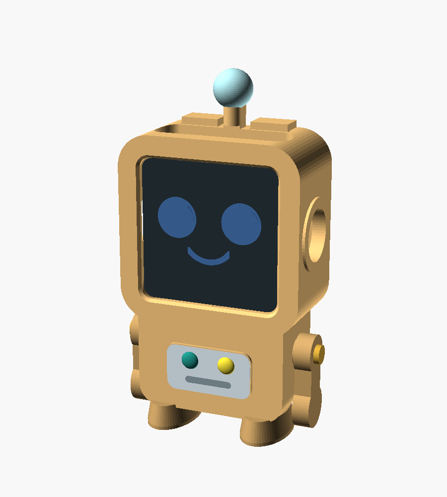
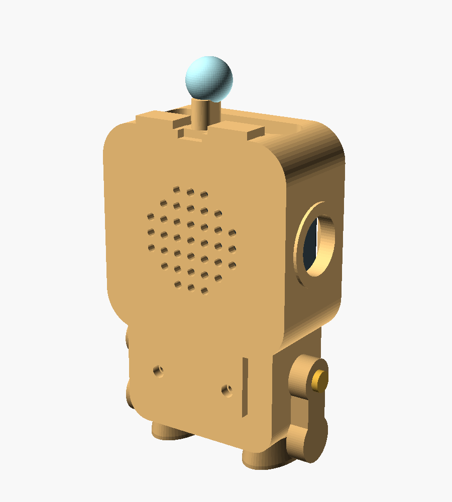

# Rory's body (3D printed)

A small Rory, about **10 cm tall**, shaped like Rory in the app. The
Waveshare board stays in its own white case; the whole case slides into
Rory's head from the back, the screen becomes her face, and the back cover
holds it in.

| Front | Back |
|---|---|
|  |  |

## Parts

| File | Print | Color |
|---|---|---|
| `stl/rory_body.stl` | 1 | peach / orange (head, body, feet and antenna in one piece) |
| `stl/rory_cover.stl` | 1 | peach |
| `stl/rory_arm.stl` | **2** | peach or tan |

Plus **4 × M3 × 12 mm pan-head self-tapping screws** (2 hold the cover, 2
are the shoulder bolts the arms swivel on). A small mixed box of M3
self-tapping screws costs a few dollars.

## Ordering a print

Upload the three STL files to a service such as
[JLC3DP](https://jlc3dp.com) or [Craftcloud](https://craftcloud3d.com), or
take them to a library or makerspace. Ask for:

* **Material:** PLA (or PETG for extra toughness)
* **Layer height:** 0.2 mm
* **Walls:** 3 (or 1.2 mm) — makes it strong for little hands
* **Infill:** 20 %
* **Supports:** yes, touching the build plate only
* **Orientation:** body lying **on its back** (face up); cover and arms flat
* **Quantity:** remember **2 arms**

## Painting (optional)

PLA takes acrylic paint and paint pens well. To match the app:

* chest panel — pale blue, with a **teal** left button and **yellow** right button
* antenna ball — light blue
* feet (and arms, if printed in peach) — tan
* screw heads — brass/gold paint pen, they become Rory's shoulder bolts

## Putting her together

1. Copy Rory's voice clips onto the microSD card and put it in the board.
2. Slide the board (in its white case) into the head **from the back**,
   screen first, buttons on top.
3. Hook the cover's two tabs over the top of the head, swing it down, and
   fix it with 2 screws at the bottom of her back.
4. Screw on the arms — snug, but loose enough to swing.
5. To charge, plug the USB-C cable in **from underneath** (between her feet)
   and lay her on her back. She'll think she's being tucked in. 😊

## Before you print: check the fit

The sizes come from Waveshare's outline drawing (46 × 46 × 22.5 mm case,
5.8 mm corner radius), but a few hole positions weren't marked clearly.
When the board arrives, measure and adjust these at the top of
[`rory_body.scad`](rory_body.scad), then re-export:

| Setting | What it is | Default |
|---|---|---|
| `btn_y` | where the 3 top buttons are, front-to-back, from the case front | 4 – 16.4 mm |
| `usb_y` | where the USB-C port is on the bottom, from the case front | 3 – 19.5 mm |
| `ear_d` | size of the side windows (microSD slot, side hole) | 15 mm |
| `clr` | clearance around the case (bigger = looser) | 0.4 mm |

Make sure nothing covers the microphones or the speaker. The back cover has
a grille of holes, and the top, sides and bottom have windows.

## Editing

The design is [OpenSCAD](https://openscad.org) (free). Open
`rory_body.scad`, change `part = "all"` to `"body"`, `"cover"` or `"arm"`,
then **Render (F6)** and **Export STL (F7)**. Or from the command line:

```bash
openscad -o stl/rory_body.stl  -D 'part="body"'  rory_body.scad
openscad -o stl/rory_cover.stl -D 'part="cover"' rory_body.scad
openscad -o stl/rory_arm.stl   -D 'part="arm"'   rory_body.scad
```

## Safety

* The board's battery stays inside Waveshare's own case, behind a screwed-on
  cover.
* Arms are held by screws, not glue or snaps, so they don't pop off.
* Use a **protected** LiPo battery, and check its plug polarity before
  connecting (red wire to **+**).
